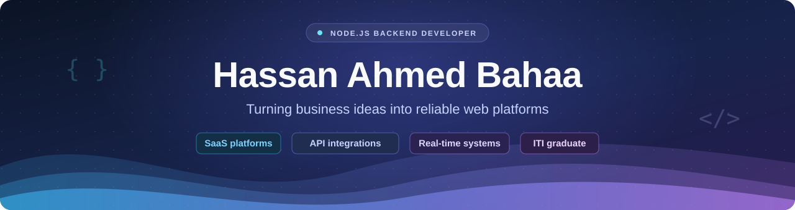
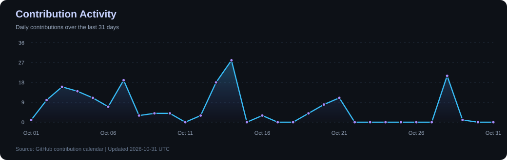

### Building the backend behind useful web products

**Node.js & TypeScript | SaaS platforms | API integrations | Real-time systems**

---

<h2>&#128187; About me</h2>

I'm **Hassan Ahmed Bahaa**, a **Node.js Backend Developer** based in Cairo, Egypt.

I build web platforms that help businesses manage their work, from order tracking and financial operations to online learning and lesson bookings. I work on the backend, databases, integrations, and deployment.

- **Backend Developer at Tayel AI Labs**, part-time and remote.
- **Freelance developer on Mostaql and Khamsat**, working with clients from requirements to delivery.
- **ITI graduate** and **Computer Science graduate from Assiut University**.
- Hands-on work with **SaaS platforms, payments, OAuth, webhooks, queues, and live classrooms**.

<h2>&#9889; What I work on</h2>

| Business platforms | APIs & integrations | Learning systems |
| :--- | :--- | :--- |
| Merchant accounts, subscriptions, permissions, and financial workflows | Store connections, order sync, payments, and background processing | Lesson bookings, live classrooms, assignments, and progress tracking |

<h2>&#128736; Languages & tools</h2>

<table>
<tr>
<td width="50%" valign="top">
<h3>Backend development</h3>

Node.js, TypeScript, JavaScript, Express.js

REST APIs, GraphQL, authentication, access control, and business logic.

</td>
<td width="50%" valign="top">
<h3>Databases & data access</h3>

PostgreSQL, MongoDB, MySQL, Redis, Prisma, Sequelize, Mongoose

Data modeling, relationships, transactions, caching, and query optimization.

</td>
</tr>
<tr>
<td width="50%" valign="top">
<h3>Integrations & real-time systems</h3>

OAuth, webhooks, BullMQ, Socket.IO, Zoom Video SDK, and payment integrations.

Order synchronization, retries, event processing, notifications, and live sessions.

</td>
<td width="50%" valign="top">
<h3>Tools & deployment</h3>

Docker, Nginx, Git, GitHub Actions, Cloudflare, and Postman

Deployment workflows, API testing, version control, and debugging.

</td>
</tr>
</table>

**Web development:** React, HTML, CSS, JavaScript, and Bootstrap.

Technology icons by <a href="https://skillicons.dev">Skill Icons</a>.

<h2>&#128200; Contribution Activity</h2>

<h2>&#128640; Featured projects</h2>

<table>
<tr>
<td width="50%" valign="top">
<h3>&#128230; Rakada</h3>

<strong>Order & COD Financial Management</strong>

A SaaS platform that helps merchants track orders, cash-on-delivery collections, returns, and shipping company payments.

<ul>
<li>Merchant data isolation and staff permissions</li>
<li>Salla OAuth, webhooks, and background order sync</li>
<li>Subscriptions and financial reconciliation</li>
<li>Deployment with Docker, Nginx, and Cloudflare</li>
</ul>

<strong>My role:</strong> Backend architecture, database design, integrations, financial workflows, and deployment.

<strong>Stack:</strong> Node.js, PostgreSQL, Sequelize, Redis, BullMQ

<a href="https://rkada.com/">Visit the product &#8599;</a>

</td>
<td width="50%" valign="top">
<h3>&#128214; Markaz Iqraa</h3>

<strong>Quran Learning Web Platform</strong>

A web platform connecting students, teachers, parents, supervisors, and administrators.

<ul>
<li>Individual and group bookings, attendance, and assignments</li>
<li>Role-based access and student progress tracking</li>
<li>Wallets, packages, refunds, and teacher payouts</li>
<li>Live classrooms with Quran sync, whiteboards, and shared PDF pages</li>
</ul>

<strong>My role:</strong> Backend development, database design, permissions, integrations, booking and financial workflows, and deployment.

<strong>Stack:</strong> Node.js, PostgreSQL, Prisma, Redis, BullMQ, Socket.IO

<strong>Frontend:</strong> Developed by Mayar Emad from the client's Figma designs.

<a href="https://mostaql.com/u/Hassanabahaa4/portfolio">Explore my portfolio &#8599;</a>

</td>
</tr>
<tr>
<td width="50%" valign="top">
<h3>&#9989; TaskFlow</h3>

<strong>Task Management Platform</strong>

A web application for managing and assigning tasks, with email activation, creator permissions, status filtering, and pagination.

<strong>Stack:</strong> Node.js, Express.js, MongoDB, JWT, JavaScript, Bootstrap

<a href="https://github.com/HassanABahaa/Task-Flow">Source code</a> | <a href="https://tasskfloow.netlify.app">Demo</a>

</td>
<td width="50%" valign="top">
<h3>&#127860; Online Food Ordering</h3>

<strong>Full-Stack Web Prototype</strong>

A food ordering website with a menu, cart, order tracking, authentication, and an admin dashboard. Online payment uses a demonstration flow.

<strong>Stack:</strong> Node.js, Express.js, MongoDB, React, Vite

<a href="https://github.com/HassanABahaa/Online-Food-Ordering">Source code</a> | <a href="https://online-food-ordering-frontend-six.vercel.app">Demo</a>

</td>
</tr>
</table>

<h2>&#129309; Let's connect</h2>

Open to **backend development opportunities**, **freelance web projects**, and **collaboration**.

[LinkedIn](https://www.linkedin.com/in/hassan-ahmed-bahaa/) | [Mostaql portfolio](https://mostaql.com/u/Hassanabahaa4/portfolio) | [Email](mailto:hassanahmedbahaa@gmail.com)

